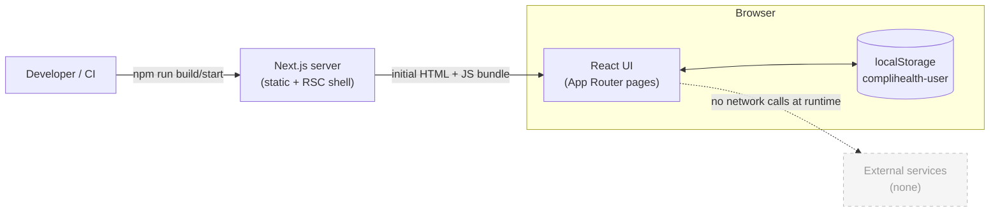
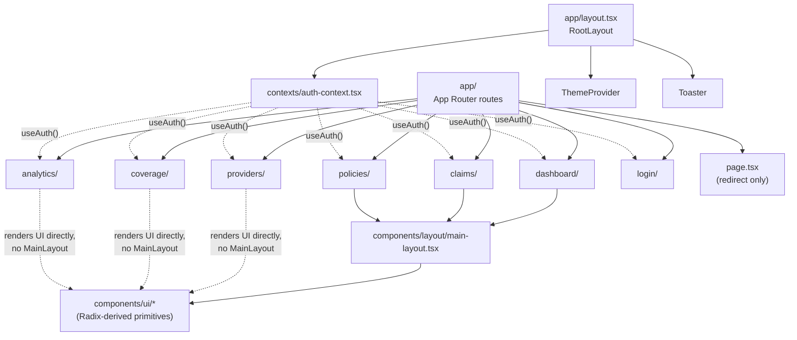
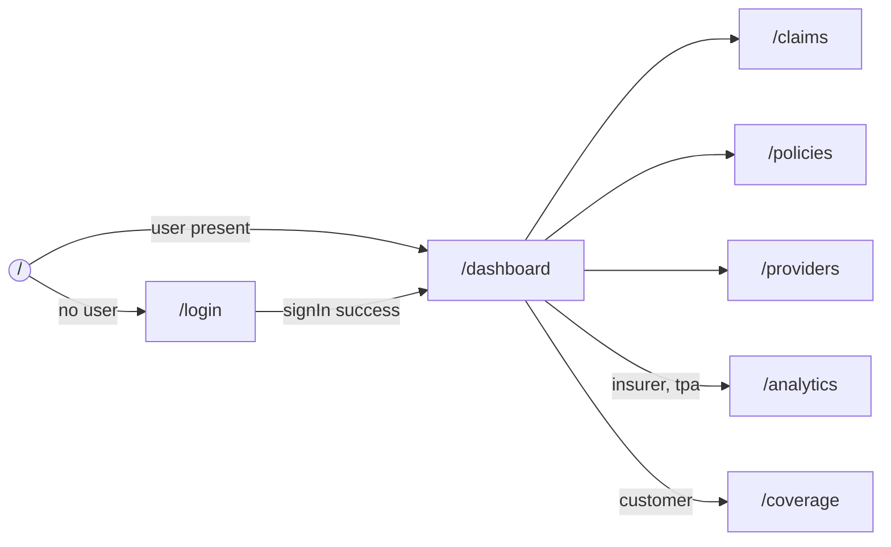
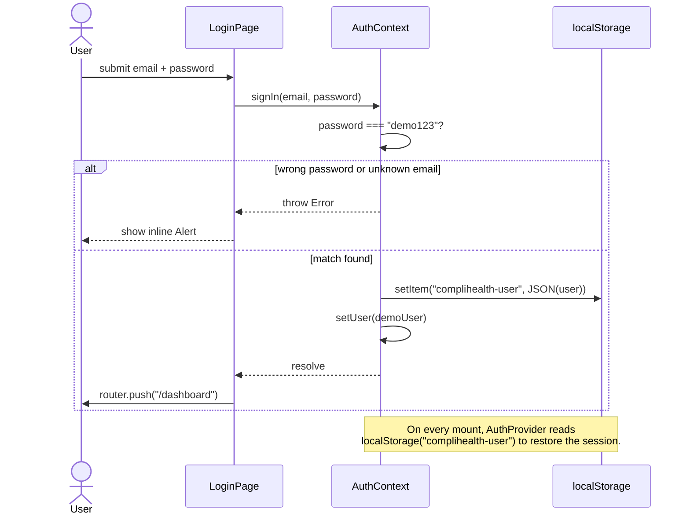
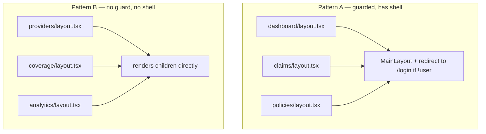
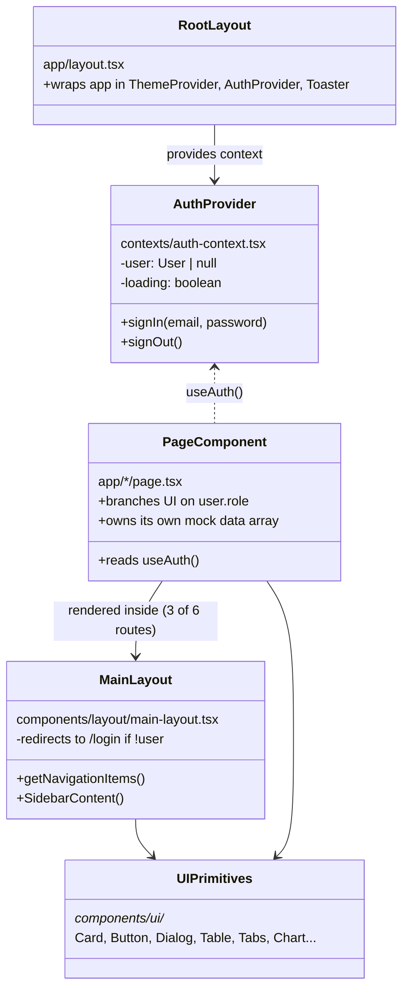
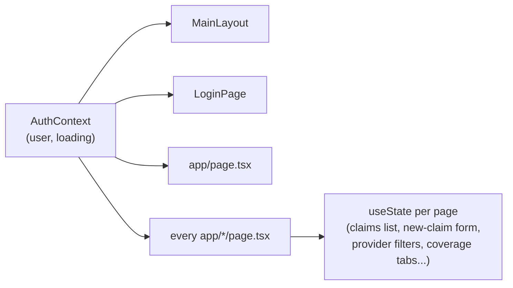
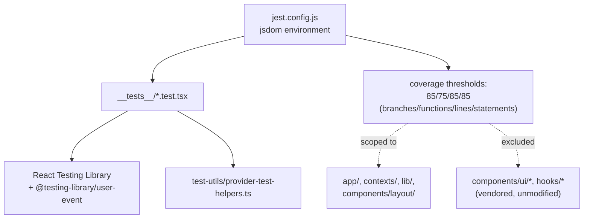
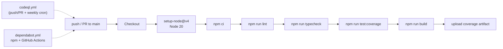

# CompliHealth — Technical Architecture

This document describes how CompliHealth is actually built today: the runtime architecture, the
routing and authentication model, the data shapes each page uses, and the known structural
limitations. It is written for engineers picking up the codebase, not for end users — see the
[README](../README.md) for a product-level overview.

> **Scope reminder.** CompliHealth is a self-contained frontend demo. There is no backend, no
> database, and no network layer. "Data model" below means the shape of the in-memory objects each
> page defines, not a persisted schema.

## Contents

1. [System context](#1-system-context)
2. [Technology stack](#2-technology-stack)
3. [Module layout](#3-module-layout)
4. [Routing and navigation](#4-routing-and-navigation)
5. [Authentication flow](#5-authentication-flow)
6. [Authorization model (role-based UI)](#6-authorization-model-role-based-ui)
7. [Component architecture](#7-component-architecture)
8. [Page data models](#8-page-data-models)
9. [State management](#9-state-management)
10. [Testing architecture](#10-testing-architecture)
11. [CI / build pipeline](#11-ci--build-pipeline)
12. [Known architectural limitations](#12-known-architectural-limitations)
13. [Extension points for a real backend](#13-extension-points-for-a-real-backend)

---

## 1. System context

CompliHealth runs entirely in the browser. The Next.js server only serves static assets and
server-rendered shells — it does not talk to any database, external API, or identity provider.

There is no API layer, no `fetch`/`axios` usage, and no environment configuration — confirmed by
the absence of any service/repository module under [`lib/`](../lib/utils.ts), which contains only
a Tailwind class-merging helper.

## 2. Technology stack

| Layer | Technology | Notes |
|---|---|---|
| Framework | Next.js 15 (App Router) | Client-rendered pages (`"use client"`) almost throughout |
| UI runtime | React 19 | |
| Language | TypeScript 5 | `strict: true`, but see [§12](#12-known-architectural-limitations) |
| Styling | Tailwind CSS + `tailwindcss-animate` | Utility classes, no CSS modules |
| Components | Radix UI primitives, wrapped in `components/ui/*` (shadcn/ui pattern) | Vendored, not hand-written |
| Theming | `next-themes` | Light/dark, `class` attribute strategy |
| Charts | Recharts | Used only in `app/analytics` |
| Testing | Jest + React Testing Library + `@testing-library/user-event` | jsdom environment |
| CI | GitHub Actions + CodeQL + Dependabot | See [§11](#11-ci--build-pipeline) |

## 3. Module layout

- `app/*` — one folder per route; each route pairs a `layout.tsx` (auth guard, if any) with a
  `page.tsx` (the actual screen and its in-memory data).
- `components/layout/main-layout.tsx` — the authenticated app shell: sidebar nav, mobile sheet,
  user menu, sign-out. Only rendered by routes whose `layout.tsx` calls it (see [§6](#6-authorization-model-role-based-ui)).
- `components/ui/*` — vendored shadcn/ui-style primitives over Radix UI; not application logic.
- `contexts/auth-context.tsx` — the only cross-cutting application state.
- `lib/utils.ts` — `cn()` class-merge helper; the entire shared-logic layer.

## 4. Routing and navigation

Navigation items are computed per-role in `MainLayout.getNavigationItems()`
([`components/layout/main-layout.tsx:68-86`](../components/layout/main-layout.tsx)):

All four roles always see **Dashboard, Claims, Policies, Providers**. **Analytics** is added only
for `insurer`/`tpa`; **Coverage** is added only for `customer`. `hospital` gets the base four items
and no role-specific extra tab.

## 5. Authentication flow

Authentication is a local, unsigned demo mechanism — there is no server round-trip.
`AuthProvider` ([`contexts/auth-context.tsx`](../contexts/auth-context.tsx)) seeds four
hardcoded `DEMO_USERS` and accepts the single password `demo123` for all of them.

Sign-out (`AuthContext.signOut`) clears `localStorage` and pushes `/login`.

**This is a demo mechanism, not real authentication** — see [§12](#12-known-architectural-limitations)
and [SECURITY.md](../SECURITY.md) for the explicitly accepted risk.

## 6. Authorization model (role-based UI)

There are **four roles**: `customer`, `hospital`, `tpa`, `insurer`. Authorization is pure
client-side conditional rendering — `user.role === "..."` checks scattered through each page — not
a real permission system. There is no server to enforce any of it.

| Area | customer | hospital | tpa | insurer |
|---|---|---|---|---|
| Dashboard content | Policies, claims, coverage %, premium | Patients, claims submitted, approval rate | Claims queue, processing stats | Portfolio-level policy/claims/revenue stats |
| Claims page title / action | "My Claims", read-only | "Submit Claims", can open **New Claim** form | "Process Claims", read-only | "Claims Overview", read-only |
| Policies page | Own policies + coverage-breakdown dialog | — (not role-branched) | Manages policies | Views all underwritten policies |
| Providers page | Can book a demo appointment | View only | View only | View only |
| Coverage tab (nav) | **Shown** | Hidden | Hidden | Hidden |
| Analytics tab (nav) | Hidden | Hidden | **Shown** | **Shown** |

Route-level guarding is **not consistent**, which matters more than the table above:

`providers`, `coverage`, and `analytics` render with **no auth check and no navigation chrome** at
the layout level — each page component individually decides what to do with a possibly-`null`
`user`. Treat `user.role` as advisory UI state, not a security boundary, anywhere in this app.

## 7. Component architecture

`MainLayout` ([`components/layout/main-layout.tsx`](../components/layout/main-layout.tsx), 250
lines) is a single component that owns the sidebar, the mobile `Sheet`, the user dropdown, and
role-to-label mapping (`getRoleDisplayName`) with no internal decomposition.

## 8. Page data models

No shared domain-types module exists. Two routes declare local `interface`s; the rest infer shapes
from literal mock arrays.

```mermaid
classDiagram
    class Claim {
        <<app/claims/page.tsx>>
        id: string
        claimNumber: string
        diagnosis: string
        treatmentDetails: string
        claimAmount: number
        approvedAmount?: number
        status: submitted|under_review|approved|rejected|paid
        submissionDate: string
        processedDate?: string
        provider: string
    }

    class Policy {
        <<app/policies/page.tsx>>
        id: string
        policy_number: string
        policy_type: string
        premium_amount: number
        coverage_amount: number
        start_date: string
        end_date: string
        status: string
        deductible: number
        copay: number
        out_of_pocket_max: number
        network_type: string
    }

    class Coverage {
        <<app/policies/page.tsx>>
        category: string
        covered: boolean
        coverage_percentage: number
        annual_limit?: number
        notes?: string
    }

    class Provider {
        <<app/providers/page.tsx, untyped literal>>
        id: number
        name: string
        type: string
        specialty: string
        networkStatus: string
        acceptingPatients: boolean
        services: string[]
        hours: object
        insurance: string[]
    }

    Policy "1" --> "*" Coverage : coverage breakdown dialog
```

- `Claim` and `Policy`/`Coverage` are the only typed interfaces in the codebase.
- `providersData`, the eight analytics datasets (`app/analytics/page.tsx:41-122`), and the
  dashboard's per-role stat/activity arrays are untyped literals — their shape is implicit.
- `statusColors` / status-badge maps are redefined independently in `claims/page.tsx` and
  `policies/page.tsx` rather than shared.
- All of the above is **static, in-memory, and reset on page reload** — nothing here is persisted.

## 9. State management

There is exactly one piece of cross-route shared state: `AuthContext`. Everything else is
component-local `useState`.

No Redux/Zustand/Context beyond `AuthContext`, no React Query/SWR (nothing to fetch), no URL-driven
state (filters in `providers`/`analytics` live in component state, not search params).

## 10. Testing architecture

14 suites cover auth, routing redirects, and each page's role-conditional rendering
(`providers-accessibility`, `providers-book-appointment`, `providers-integration`, etc.). Coverage
is enforced in CI but gaps concentrate in `app/dashboard/page.tsx` (~65% branches) and
`contexts/auth-context.tsx` (~50% branches) per the project's own [360° audit](../360_AUDIT_REPORT.md).

## 11. CI / build pipeline

`.github/workflows/ci.yml` runs one job: lint → typecheck → test:coverage → build, single Node 20
version, least-privilege `permissions: contents: read`. `codeql.yml` and `dependabot.yml` run
independently.

## 12. Known architectural limitations

These are current, verified facts about this codebase, not hypothetical risks — see the full
[360° Audit Report](../360_AUDIT_REPORT.md) for the complete evidence and scoring.

1. **Build safety nets are disabled.** `next.config.mjs` sets `typescript.ignoreBuildErrors: true`
   and `eslint.ignoreDuringBuilds: true`, so `tsconfig.json`'s `strict: true` does not actually gate
   the production build.
2. **Auth state is forgeable client-side.** The full session object, including `role`, is stored
   unsigned in `localStorage` (`contexts/auth-context.tsx:97`) — editable in devtools to escalate
   to any role, with no server to check it against. This is a disclosed, accepted demo risk — see
   [SECURITY.md](../SECURITY.md).
3. **Inconsistent route guarding** — three different patterns across six routes, detailed in
   [§6](#6-authorization-model-role-based-ui). `providers`, `coverage`, and `analytics` have no
   auth check and render without the app shell.
4. **No data/service layer.** `lib/` contains only `cn()`. Every route hand-rolls its own mock data
   and status-color map; swapping in a real backend means touching every page individually.
5. **No security headers** (CSP, HSTS, X-Frame-Options, X-Content-Type-Options) configured in
   `next.config.mjs`.
6. **PII-shaped logging.** `contexts/auth-context.tsx` logs the user's email to the console on every
   sign-in and session restore — harmless today, but a habit that would leak PII if ever wired to a
   real logging backend.

## 13. Extension points for a real backend

If this app ever grows a real backend, the natural seams are:

- **`lib/`** — add a typed service/repository layer here (`lib/claims.ts`, `lib/policies.ts`, ...)
  behind the same function signatures the pages already call conceptually
  (`fetchPolicies`-style functions already exist as stubs in `app/policies/page.tsx`).
- **`contexts/auth-context.tsx`** — replace `DEMO_USERS`/`localStorage` with a real OAuth/OIDC
  client and server-side session, keeping the `AuthContextType` shape (`user`, `loading`, `signIn`,
  `signOut`) so page components don't need to change.
- **Route `layout.tsx` files** — unify the three guarding patterns into one shared layout component
  before adding real authorization, so `providers`/`coverage`/`analytics` stop being the
  unguarded exception.
- **Shared domain types** — promote the `Claim`, `Policy`, and `Coverage` interfaces (and the
  currently-untyped `Provider`/analytics shapes) into a shared `types/` module consumed by both the
  future service layer and the existing pages.
